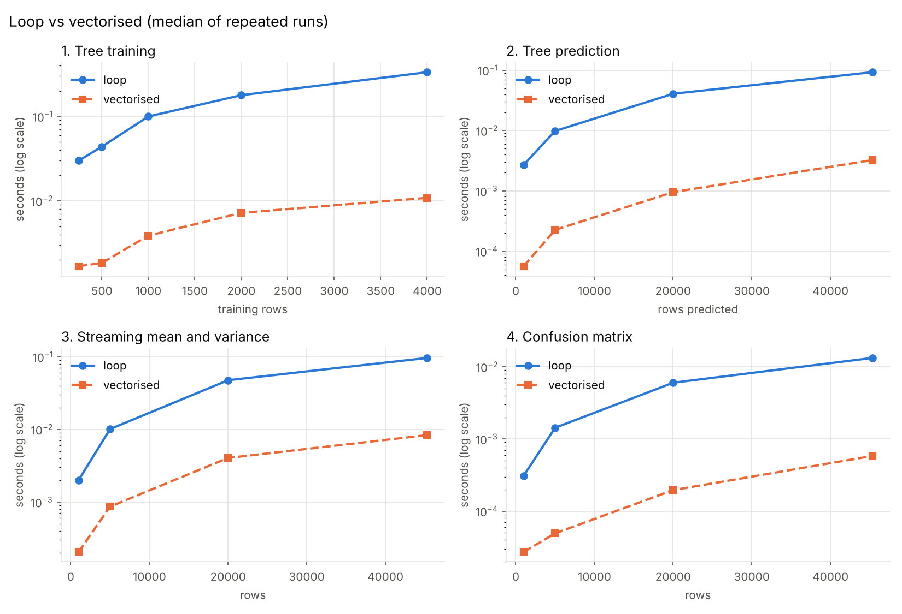
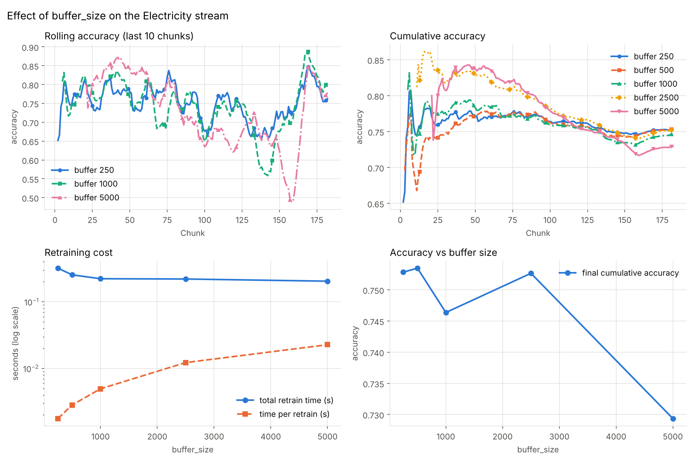

# numcompute_stream

**A streaming, decision-tree-based machine learning framework built from scratch with NumPy.**

`numcompute_stream` extends the NumCompute toolkit (Assignment 1) for *online learning*: data arrive in chunks, every component learns incrementally through `partial_fit()` / `update()` / `update_stats()`, and a single decision tree handles the stream by **buffered retraining**: chunks are collected in a buffer and the tree is rebuilt whenever the buffer holds `buffer_size` samples.

Only **NumPy** and **matplotlib** are used (plus the Python standard library). No scikit-learn, pandas or SciPy.

> The original group package from Assignment 1 is still in `numcompute/`, and its documentation has moved to [`numcompute/docs/README_assignment1.md`](numcompute/docs/README_assignment1.md). The new package reuses its validation helpers (`numcompute.utils`) and ranking (`numcompute.rank`).

---

## Contents

- [Project structure](#project-structure)
- [Installation](#installation)
- [Quick start](#quick-start)
- [Modules](#modules)
- [The buffered decision tree](#the-buffered-decision-tree)
- [Design decisions](#design-decisions)
- [Testing](#testing)
- [Demo notebook](#demo-notebook)
- [Benchmarks](#benchmarks)
- [Data](#data)
- [Limitations](#limitations)

## Project structure

```
numcompute_stream/          the new streaming package
    __init__.py             public API (import everything from here)
    utils.py                shared input validation and error messages
    base.py                 base classes: StreamingTransformer, StreamingClassifier, StreamingMetric
    io.py                   read_csv, iter_csv_chunks, chunk_array
    tree.py                 DecisionTreeClassifier (buffered retraining)
    stats.py                StreamingStats, StreamingHistogram
    preprocessing.py        StandardScaler, Imputer, OneHotEncoder
    metrics.py              Accuracy, Precision, Recall, F1, ConfusionMatrix, ROCAUC (+ batch functions)
    pipeline.py             Pipeline with partial_fit
    stream.py               StreamTrainer (test-then-train loop with logging)
    visualise.py            plot_metric_over_time, compare_models, plot_predictions_vs_ground_truth, ...
tests/                      test_stream_*.py for the new package (plus the Assignment 1 tests)
demo/stream_demo.ipynb      end-to-end streaming demo (already executed, with outputs)
demo/figures/               figures saved by the demo
benchmark/                  loop vs vectorised, and buffer_size experiments
benchmark/results/          CSV results and plots from the benchmarks
data/elec.csv               Electricity Market stream data set (see data/README.md)
numcompute/                 Assignment 1 package (unchanged)
```

## Installation

You need Python 3.9 or later.

```bash
git clone https://github.com/KKRISHNANAMIKAZE/KRISHNA-KUMAR-SIRAIMEETAN.git
cd KRISHNA-KUMAR-SIRAIMEETAN
git checkout individual/kk
python -m pip install numpy matplotlib pytest
```

Optionally install the project as a package (then it can be imported from anywhere):

```bash
python -m pip install -e .
```

To run the demo notebook you also need Jupyter: `python -m pip install notebook`.

## Quick start

```python
from numcompute_stream import (
    Pipeline, Imputer, StandardScaler, DecisionTreeClassifier,
    StreamTrainer, iter_csv_chunks,
)
from numcompute_stream.visualise import plot_metric_over_time

pipe = Pipeline([
    ("impute", Imputer()),
    ("scale", StandardScaler()),
    ("model", DecisionTreeClassifier(max_depth=5, buffer_size=1000)),
])

trainer = StreamTrainer(pipe, verbose=True)          # test-then-train + logging
trainer.run(iter_csv_chunks("data/elec.csv", 250, label_column="class"))

print(trainer.summary())
plot_metric_over_time(trainer.get("cumulative_accuracy"),
                      title="Cumulative accuracy", ylabel="accuracy",
                      retrain_points=trainer.retrain_chunks(), show=True)
```

Each line of the verbose log looks like:

```
chunk   8 | seen   2000 | chunk acc 0.608 | cumulative acc 0.740 | buffer 0 | mem 4.1 KB  RETRAINED
```

Using the tree directly, exactly as in the specification:

```python
tree = DecisionTreeClassifier(max_depth=5, buffer_size=500)
for X_chunk, y_chunk in stream:
    tree.partial_fit(X_chunk, y_chunk)
tree.predict(X_new)
```

## Modules

**Shape conventions (every module):** `X` is a 2-D float array of shape `(n_samples, n_features)` (rows = samples, axis 0); `y` is 1-D of shape `(n_samples,)` with integer or text labels. A 1-D `X`, a wrong number of columns, NaN where it is not allowed, infinity, or mismatched lengths all raise a clear `ValueError` or `TypeError` that names the problem, for example:

```
ValueError: X has 2 features, but StandardScaler was fitted with 3 features
NotFittedError: This DecisionTreeClassifier instance is not fitted yet. ... The buffer
                holds 600 of 1000 samples needed for the first tree; call flush() to train on them now.
```

| Module | Main objects | Streaming API |
|---|---|---|
| `io` | `read_csv`, `iter_csv_chunks`, `chunk_array` | `iter_csv_chunks` reads the file lazily, `chunk_size` rows at a time; `chunk_array` splits in-memory data (optionally shuffled, with a seed) |
| `tree` | `DecisionTreeClassifier` | `partial_fit` buffers and retrains; `fit`, `flush`, `predict`, `predict_proba`, `apply`, `export_text`, `get_depth`, `get_n_leaves` |
| `stats` | `StreamingStats`, `StreamingHistogram` | `update_stats(X_chunk)` updates count, mean, variance, std, min, max, NaN count and quantiles; the histogram supports a sliding `window` |
| `preprocessing` | `StandardScaler`, `Imputer`, `OneHotEncoder` | `partial_fit` updates running mean/variance, fill values, and categories |
| `metrics` | `Accuracy`, `Precision`, `Recall`, `F1`, `ConfusionMatrix`, `ROCAUC` | `update(y_true, y_pred)`, `result()`, `reset()`; `window=k` gives a rolling metric over the last `k` chunks |
| `pipeline` | `Pipeline` | `partial_fit` updates every step in order; `predict`, `predict_proba`, `score`, `flush`, `clone`, `reset` |
| `stream` | `StreamTrainer` | `fit_chunk`, `score_chunk`, `process_chunk`, `run`; logs per-chunk metrics, memory footprint and cumulative accuracy |
| `visualise` | `plot_metric_over_time`, `compare_models`, `plot_predictions_vs_ground_truth`, `plot_confusion_matrix`, `plot_benchmark` | every function takes `ax=`, `save_path=` and `show=` and returns `(fig, ax)` |
| `base` | `StreamingTransformer`, `StreamingClassifier`, `StreamingMetric` | shared interfaces plus `get_params`, `set_params`, `clone` |
| `utils` | `check_X`, `check_X_y`, `check_n_features`, `check_is_fitted`, `NotFittedError`, ... | one place for every input check, reusing `numcompute.utils` |

Batch helpers are also available: `accuracy_score`, `precision_score`, `recall_score`, `f1_score`, `confusion_matrix` and an exact rank-based `roc_auc_score`.

## The buffered decision tree

```python
DecisionTreeClassifier(max_depth=5, min_samples_split=2, max_features=None,
                       criterion="gini", buffer_size=500,
                       implementation="vectorized", allow_new_features=False,
                       random_state=None)
```

* **`partial_fit(X_chunk, y_chunk)`** appends the chunk to the buffer. Once the buffer holds **at least** `buffer_size` samples, the tree is retrained on the buffered data **only** and the buffer is cleared. A chunk larger than `buffer_size` triggers exactly one retrain on all of it. An empty chunk is ignored.
* **Between retrains**, `predict` uses the most recent tree. Before the first tree exists, `predict` raises `NotFittedError` saying how full the buffer is; `flush()` trains on a partly full buffer straight away.
* **`fit(X, y)`** trains from scratch immediately, ignoring the buffer.
* Every build is logged in `retrain_log_` (training size, seconds, stream position); `n_retrains_` counts builds and `buffer_count_` shows the buffer size.
* Labels may be integers or text. A class that first appears after the last retrain is added to `classes_` and gets probability 0 until the next retrain. Changing label type mid-stream (numbers → text) raises `TypeError`.

**How a tree is grown** (same rules and order as the course guide): a node becomes a leaf if it is at `max_depth`, if it is pure, if it has fewer than `min_samples_split` samples, or if no split has information gain above 0. Otherwise it asks `X[:, f] <= t` with the largest gain (Gini or entropy), sends "yes" rows left, and grows the left child first.

## Design decisions

* **Vectorised split search.** For each feature the rows are sorted once; a cumulative sum of one-hot class counts gives the left and right class counts for *every* threshold at once, and all impurities come from one array expression. Thresholds are midpoints between neighbouring distinct values, so real-valued features work (the course example only had 0/1 features). Features are processed in blocks so the temporary array stays under 4 million elements.
* **Vectorised prediction.** The tree is stored as flat arrays (`feature`, `threshold`, `left`, `right`, `value`). All samples move down one level at a time with `np.where`, so the Python loop runs once per level (at most `max_depth` times), never once per sample.
* **Deterministic tie rules.** Gains are rounded to 12 decimals; a split must beat the best so far *strictly*, so ties go to the lowest feature index, then the lowest threshold; a leaf tie goes to the first class in `classes_` (like `np.bincount(y).argmax()`). The loop and vectorised implementations therefore build identical trees, which the tests check.
* **Numerical stability.** Running mean and variance use Chan et al.'s parallel merge (the chunk form of Welford's algorithm), which stays exact even for values around 10⁹ where the naive formula fails. A zero-variance feature gets scale 1 (output 0, not NaN). Entropy treats 0·log 0 as 0. Zero-division in precision/recall/F1 returns 0 without warnings.
* **NaN policy.** `Imputer` fills NaN with running estimates; `StandardScaler` and `StreamingStats` skip NaN per feature; the tree refuses NaN with a message pointing to `Imputer`; metrics refuse NaN labels.
* **Quantiles: exact or approximate, chosen explicitly.** `StreamingStats(quantile_method="exact")` keeps every row (matches `np.nanquantile`); `"reservoir"` (default) keeps a uniform random sample of `capacity` rows (Algorithm R, vectorised per chunk) for fixed memory and is exact until the stream exceeds `capacity`. Five interpolation methods are supported: linear, lower, higher, nearest, midpoint.
* **Honest evaluation.** `StreamTrainer` scores each chunk *before* training on it (prequential / test-then-train), so accuracy is always measured on unseen data.
* **Growing one-hot output.** `OneHotEncoder` adds a new category as a new column at the *right-hand end*, so existing columns never move; with `allow_new_features=True` the tree pads its buffer with zeros for the new columns and ignores them until the next retrain. The default is strict (`False`), so a wrong column count is an error, not silent broadcasting.
* **Streaming AUC in fixed memory.** `ROCAUC` keeps two score histograms (1000 bins) and integrates the ROC curve from their cumulative sums; it matches the exact rank-based AUC to within 0.001 in the tests.
* **Shared base classes.** Every transformer, classifier and metric follows one of three interfaces in `base.py`, so `Pipeline` and `StreamTrainer` work with any of them, and `clone()` makes fresh copies for comparisons.

## Testing

```bash
python -m pytest            # all tests (Windows: use python -m pytest, not pytest)
python -m pytest tests/test_stream_tree.py -v
```

The whole repository has **293 passing tests**: 161 from Assignment 1 and **132 new test cases (113 test functions)** for `numcompute_stream`:

| Test file | Cases | What it covers |
|---|---|---|
| `test_stream_tree.py` | 35 | course 12-student example (depth 2 and 3, Gini and entropy), loop = vectorised trees, thresholds, tie rules, all buffering behaviour, new classes, NaN / width / label-type errors, invalid settings |
| `test_stream_stats.py` | 18 | streamed moments = NumPy (with NaN, ddof 0/1), chunk-size independence, 10⁹-offset stability, all-NaN features, 5 quantile methods, reservoir exactness, bounded memory and repeatability, histograms with windows |
| `test_stream_io.py` | 16 | headers, text/int labels, missing cells, Excel BOM, blank lines, line-numbered errors, lazy chunk reading, chunk splitting and shuffling |
| `test_stream_metrics.py` | 16 | streamed = batch confusion matrix and P/R/F1 (macro, micro, weighted), hand-computed values, zero division, rolling windows, growing labels, exact AUC vs pairwise reference, binned AUC accuracy |
| `test_stream_utils.py` | 15 | every validation helper and its message |
| `test_stream_preprocessing.py` | 12 | scaler streaming = batch, constant columns (A1 regression), NaN handling, wrong widths (A1 regression), imputer updating on the fly, one-hot growth and unknown categories |
| `test_stream_pipeline_trainer.py` | 10 | pipeline = manual chaining, step validation, clone/reset, test-then-train order, cumulative accuracy, logging, buffer size vs number of retrains |
| `test_stream_base.py` | 6 | abstract classes, params, clone, fit vs partial_fit |
| `test_stream_visualise.py` | 4 | every plot saves, keeps NaN gaps, labels and validates input |

## Demo notebook

```bash
cd demo
jupyter notebook stream_demo.ipynb
```

The notebook (saved with all outputs) loads `data/elec.csv` with `read_csv`, summarises it with `StreamingStats`, streams it in 250-row chunks through `Imputer → StandardScaler → DecisionTreeClassifier(max_depth=5, buffer_size=1000)` with `StreamTrainer`, and plots cumulative accuracy, rolling accuracy, AUC, a comparison of `buffer_size=250` vs `5000`, predictions vs ground truth on the latest unseen chunk, the learned rules, a missing-value robustness check, and a sliding-window histogram. It runs in about 10 seconds.

## Benchmarks

```bash
python benchmark/bench_loop_vs_vectorised.py
python benchmark/bench_buffer_size.py
```

Both scripts print a table, save a CSV and a PNG to `benchmark/results/`, and record the environment. Times are medians of repeated runs after a warm-up run. The numbers below were measured on Python 3.13, NumPy 2.5, Linux x86-64; your times will differ, but the ratios should be similar.

**(a) Loop vs vectorised** (every pair was checked to give identical results):

| Task | Size | Loop | Vectorised | Speed-up |
|---|---|---|---|---|
| Tree training (depth 5) | 4,000 rows | 0.334 s | 0.011 s | 31× |
| Tree prediction | 45,312 rows | 0.093 s | 0.003 s | 29× |
| Streaming mean & variance | 45,312 rows | 0.096 s | 0.008 s | 12× |
| Confusion matrix | 45,312 rows | 0.013 s | 0.0006 s | 23× |



**(b) Effect of `buffer_size`** (Electricity stream, 250-row chunks, test-then-train, depth-5 tree):

| buffer_size | Final accuracy | Retrains | Time per retrain | Total retrain time | Peak model memory |
|---|---|---|---|---|---|
| 250 | 0.753 | 181 | 1.8 ms | 0.32 s | 6 KB |
| 500 | 0.753 | 90 | 2.8 ms | 0.25 s | 21 KB |
| 1000 | 0.746 | 45 | 4.9 ms | 0.22 s | 46 KB |
| 2500 | 0.753 | 18 | 12.2 ms | 0.22 s | 128 KB |
| 5000 | 0.729 | 9 | 22.7 ms | 0.20 s | 265 KB |

Larger buffers make each retrain slower and use more memory, but there are fewer retrains, so total training time stays about the same. Accuracy is similar up to 2,500 and drops at 5,000: a big buffer means the tree is up to 20 chunks out of date, and during the market change around chunk 155 its rolling accuracy falls to about 50% while small buffers recover quickly. Note that a bigger buffer also delays the first prediction (chunk 21 for 5,000), and accuracy only counts scored chunks.



## Data

`data/elec.csv` is the Electricity Market (elec2) stream data set: 45,312 half-hourly records from New South Wales, Australia, with 6 numeric features and a binary label (price up / down). Source and citation are in [`data/README.md`](data/README.md).

## Limitations

* The tree is rebuilt from scratch at each retrain; it does not update incrementally (that is the assignment's buffered design), and data from earlier buffers is not reused.
* `ROCAUC` is for binary problems; for multi-class data use the other metrics.
* `OneHotEncoder` encodes every column it is given. The pipeline is sequential, so mixing numeric and categorical columns needs the encoder to be applied to the categorical columns before the pipeline.
* Reservoir quantiles are approximate once the stream exceeds `capacity`; use `quantile_method="exact"` for exact values on small streams.
